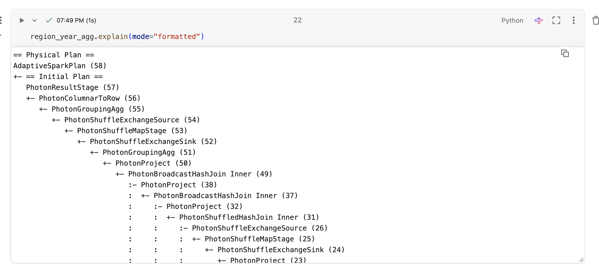
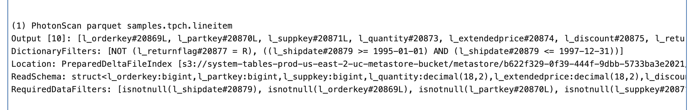
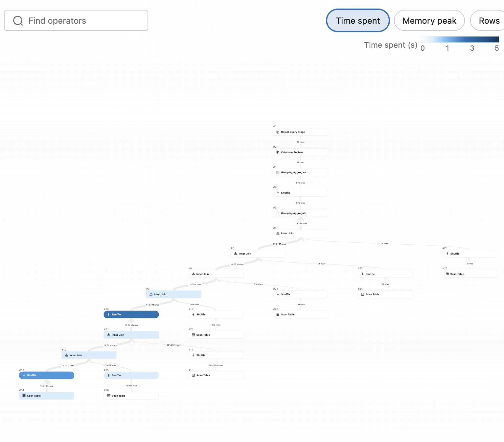
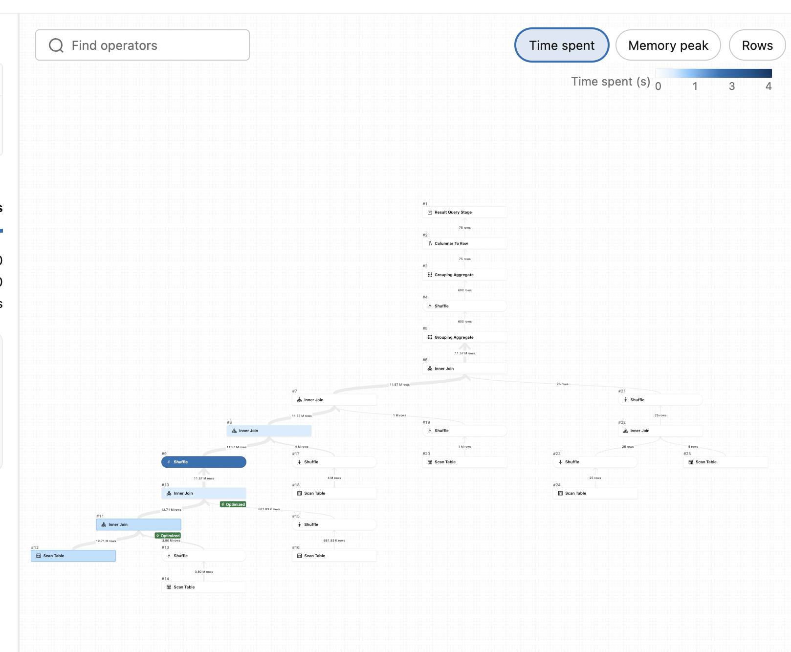
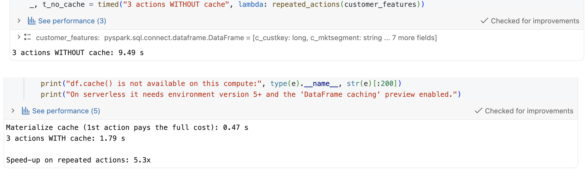
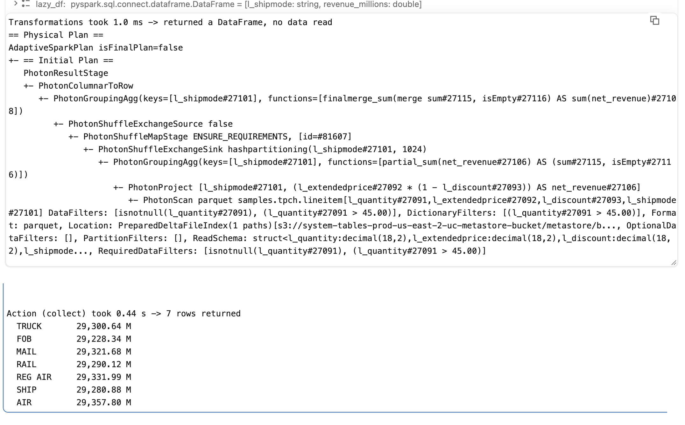
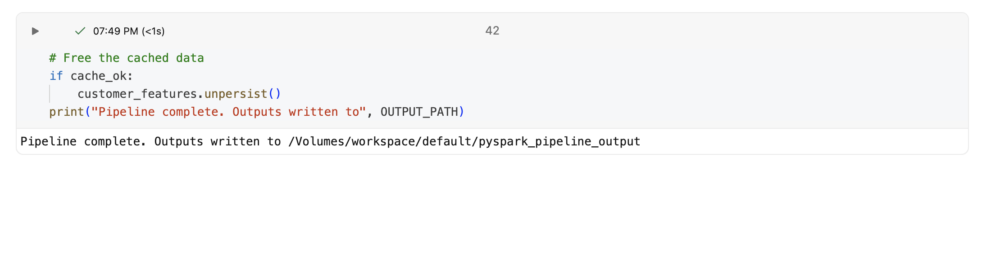

# PySpark Data Processing Pipeline: TPC-H Sales & Customer Analysis

A distributed PySpark pipeline on Databricks that joins and aggregates a 1.07 GB (43 million row) sales dataset. It demonstrates lazy evaluation, Catalyst optimizations (predicate pushdown, column pruning, broadcast joins), partitioning, caching, and MLlib customer segmentation.

---

## Repository contents

| File | Description |
|---|---|
| `pyspark_pipeline.ipynb` | The full pipeline (run on Databricks) |
| `pyspark_pipeline.html` | Exported notebook with all outputs |
| `images/` | Screenshots referenced below |

**How to run:** import the notebook into Databricks Free Edition (Workspace → Import), attach serverless compute (environment version 4+), and *Run all*. No data download is needed.

---

## Dataset

**Source:** [TPC-H benchmark](https://www.tpc.org/tpch/), available in every Databricks workspace as the `samples.tpch` catalog schema ([Databricks docs](https://docs.databricks.com/aws/en/discover/databricks-datasets)).

TPC-H is the industry-standard decision-support benchmark. It models a wholesale supplier's sales database. Tables used:

| Table | Rows | Size on disk | Role |
|---|---|---|---|
| `lineitem` | 29,999,795 | 0.702 GB | One row per item on an order (fact table) |
| `orders` | 7,500,000 | 0.176 GB | Order header: customer, date, priority |
| `partsupp` | 4,000,000 | 0.134 GB | Each supplier's cost for each part |
| `customer` | 750,000 | 0.037 GB | Market segment, account balance, nation |
| `part` | 1,000,000 | 0.019 GB | Part catalogue (type → material) |
| `nation` | 25 | < 0.001 GB | Nation → region key |
| `region` | 5 | < 0.001 GB | 5 world regions |
| **Total** | **43,249,825** | **1.07 GB** (compressed Delta/Parquet) | |

Stored as Delta tables, which are Parquet files plus a transaction log.

---

## Pipeline overview

```
lineitem ─┬─ select + filter (ship date 1995–97, not returned) + withColumn (revenue, year, delivery days, is_late)
          │
orders ───┤─ select + filter (order date)          ── shuffle join on orderkey
customer ─┤─ select + filter (acctbal >= 0)          ── join on custkey (AQE may broadcast)
partsupp ─┤─ select supply cost                      ── shuffle join on (partkey, suppkey)
part ─────┤─ select + withColumn (material)          ── join on partkey (AQE may broadcast)
nation+region ── broadcast join                       ── no shuffle of the big side
          │
          ▼  + withColumn profit = revenue − supply cost × qty
   enriched_sales ──► groupBy(region, year, segment)  ──► Parquet, partitioned by ship_year
                 ├──► SQL 1: top 2 nations per region/year (RANK window)
                 ├──► SQL 2: delivery performance by ship mode
                 ├──► SQL 3: profit margin by part material
                 └──► customer_features (cached) ──► KMeans segmentation
```

| Requirement | Where |
|---|---|
| 2+ filters | 4 filters: ship date, return flag, order date, account balance |
| Join / complex aggregation | 5 joins (one broadcast, one on a composite key) + multi-metric `groupBy` |
| `groupBy` + aggregations | Region × year × segment summary; customer features |
| `withColumn` | `net_revenue`, `profit`, `ship_year`, `delivery_days`, `is_late`, `part_material`, `avg_order_value` |
| 2+ SQL queries | Section 3: 3 queries (window-function ranking, ship-mode performance, profit by material) |
| Write results | Parquet in a Unity Catalog volume, `partitionBy("ship_year")` |

---

## Performance analysis

### Execution plan





### How Spark optimized the query

Spark builds a **logical plan** from the DataFrame code. The Catalyst optimizer rewrites it, and only then picks a **physical plan**. On Databricks serverless, that plan runs on **Photon** (Databricks' vectorized engine), so the operators are named `PhotonScan`, `PhotonGroupingAgg`, `PhotonShuffleExchangeSink`, and so on.

The plans show two optimizations directly:
- **Filter pushdown.** In the lazy-evaluation demo plan, the `PhotonScan parquet samples.tpch.lineitem` node lists `DataFilters: [isnotnull(l_quantity), (l_quantity > 45.00)]` and `DictionaryFilters: [(l_quantity > 45.00)]`. The filter runs *inside the file scan*, not as a separate step afterwards. It also uses Parquet dictionary encoding to skip data. The main pipeline shows the same thing. Its `PhotonScan parquet samples.tpch.lineitem` node lists `DictionaryFilters: [NOT (l_returnflag = R), ((l_shipdate >= 1995-01-01) AND (l_shipdate <= 1997-12-31))]`, so both of our `lineitem` filters run inside the scan.
- **Column pruning.** That scan's `ReadSchema` lists only 4 of `lineitem`'s 16 columns. In the main pipeline the scan outputs only **10** columns (`Output [10]`), even though we selected 12. Catalyst also dropped `l_tax`, which we selected but never used, and `l_returnflag`, which is needed only for the filter inside the scan.

The main pipeline's plan (`region_year_agg.explain`) shows the **join strategies** Spark chose. The large joins run as **`PhotonShuffledHashJoin`**: both sides are shuffled on the join key, then one side is built into a hash table. The smaller sides become **`PhotonBroadcastHashJoin`**: the small table is copied to every executor, so the large side never moves.

Each `groupBy` shows up as a partial `PhotonGroupingAgg` → shuffle → final `PhotonGroupingAgg` (`partial_sum` then `finalmerge_sum`), so only per-partition partial sums cross the network. The plan starts as `AdaptiveSparkPlan isFinalPlan=false`, meaning **Adaptive Query Execution (AQE)** can still change join strategies at runtime. The query profile marks two of the joins with an **"Optimized"** badge.

### Query profiles: naive vs optimized

| Naive | Optimized |
|---|---|
|  |  |

### Bottlenecks

In both query profiles, the darkest (most time-consuming) operator is the **shuffle that follows the `lineitem ⋈ orders ⋈ customer` joins**. It moves **11.57 M rows** across the cluster to be re-partitioned for the next join. This is expected: the `lineitem` and `partsupp` joins have large tables on both sides, so neither can be broadcast. Everything after the final join is cheap. The first aggregation collapses 11.57 M rows to 600 groups, so the last shuffle moves only 600 rows.

### What I optimized, and the measured effect

To quantify the optimizations, the notebook also builds a **naive** version of the same pipeline. It joins all tables first, filters last, filters on the derived `year(l_shipdate)` instead of the raw date, and has no date filter on `orders`. Both versions return the same result.

| | Naive | Optimized |
|---|---|---|
| Run 1 time | 3.40 s | 2.86 s |
| Run 2 time | 2.76 s | 2.72 s |
| Result check (groups, line items) | 75, 11,565,970 | 75, 11,565,970 (identical) |
| Total rows read (all tables) | 25,894,679 | **22,190,120** (−14%) |
| `orders` rows scanned | 7,500,000 | **3,800,000** (−49%) |
| `lineitem` rows out of scan | 12.71 M | 12.71 M |
| `customer` rows out of scan | 681.83 K | 681.83 K |

**Key finding: the optimizer repaired most of the naive code on its own.** Even though the naive version wrote its filters *after* the joins, the profiles show the `lineitem` and `customer` filters ended up inside their scans in both versions: 12.71 M and 681.83 K rows come out of each, in both plans. So *where* a filter is written in the code matters less than you might expect, because Catalyst moves filters toward the data. What the optimizer **could not** do is invent the `orders` date filter. That filter comes from domain knowledge (in TPC-H an item ships at most 121 days after its order date), not from the query itself. Adding it halved the `orders` scan and cut total rows read by 3.7 M. The time saving was modest (16% on run 1, about 1.5% on run 2 once storage was warm) because the dominant cost, the 11.57 M-row shuffle, is the same in both. The two pipelines read similar *bytes* (495 MB vs 506 MB): the optimized version reads one extra column (`o_orderdate`) to apply its filter.

### Partitioning

- Input partitions follow the Delta files: `lineitem` (10 files) is read as **8 partitions**, and filtering keeps 8 partitions. Filters reduce rows *within* partitions; they don't change how many there are.
- Shuffle partitions are coalesced automatically by AQE.
- The output is written with `repartition("ship_year")` + `partitionBy("ship_year")`: one folder per year, one file each, no small-file problem. Reading it back with `ship_year = 1996` shows `PartitionFilters: [... (ship_year = 1996)]` in the plan, so Spark opens only that folder (**partition pruning**).

### Caching (bonus)

`customer_features` (the joined and aggregated per-customer table) feeds three summary actions plus KMeans training. Without caching, every action re-runs the whole scan → join → aggregate lineage.

| | Time (s) |
|---|---|
| 3 actions **without** cache | 9.49 |
| First action after `.cache()` (materializes it) | 0.47 |
| 3 actions **with** cache | 1.79 |
| **Speed-up** | **5.3x** |



---

## Transformations vs actions

| | Time | What happened |
|---|---|---|
| `filter` → `withColumn` → `groupBy` → `agg` (transformations) | 1.0 ms | Returned a DataFrame immediately: only a plan was built, no data read |
| `.collect()` (action) | 0.44 s (~440x longer) | Spark optimized the plan, launched tasks, scanned `lineitem` |

Spark is **lazy** so that Catalyst can see the *whole* chain before running anything. That's what makes predicate pushdown, column pruning and join reordering possible.



---

## Machine learning: customer segmentation (KMeans)

Features per customer: total revenue, number of orders, average order value, average discount, late-delivery rate, average quantity. These are standardized with `StandardScaler`, because KMeans is distance-based. k was chosen from {3, 4, 5} by silhouette score.

| k | Silhouette |
|---|---|
| 3 | **0.328** |
| 4 | 0.322 |
| 5 | 0.226 |

Best k = **3**. A silhouette of 0.33 means the clusters are moderately separated, which is reasonable for synthetic data.

| Segment | Customers | Avg total revenue | Avg # orders | Avg order value | Description |
|---|---|---|---|---|---|
| 0 | 156,282 | 1,482,828 | 10.9 | 137,539 | **Loyal high-value**: order twice as often as the others, about 2x the revenue |
| 1 | 143,631 | 743,973 | 4.8 | 158,946 | **Big-basket occasional**: few orders, but the largest order size |
| 2 | 152,611 | 534,370 | 5.2 | 100,755 | **Small-basket occasional**: few, small orders, lowest revenue |

Average discount is ~5% in every segment, so discounts don't drive the segments. Order **frequency** and order **size** do.

---

## Key findings

1. **Revenue by region/segment is nearly flat.** Within a region and year, the 5 market segments differ by only about ±2% in revenue (e.g. Africa 1995: 4,666 M to 4,795 M), which fits TPC-H's uniform data generation.
2. **1995 looks ~27% lower than 1996–97, but that is a data artifact, not growth.** In TPC-H, only items received before mid-1995 can be flagged as returned (`R`). Our filter drops returned items, so it removes part of 1995 and nothing from 1996–97.
3. **Profit margin is about 65%** of net revenue in every region/segment/year (e.g. 3,046 M profit on 4,698 M revenue).
4. **No nation dominates its region.** The #1 and #2 nations in each region are separated by only about 1% of revenue (e.g. Africa 1995: Ethiopia 4,793 M vs Kenya 4,743 M), and the leaders change from year to year (America: Argentina in 1995, Brazil in 1996).
5. **Shipping mode makes no difference to delivery.** All 7 modes average about 15.5 days from ship to receipt, and about 63% of items arrive after the committed date (63.15% for FOB to 63.30% for rail). Even AIR is not faster than SHIP in this data.
6. **Every part material earns the same ~64.9% margin** (brass 64.89% down to copper 64.85%), with about 84 billion in revenue each.
7. **Customer segments:** KMeans finds 3 behavioural groups (loyal high-value, big-basket occasional, small-basket occasional), split mainly by order frequency and order size.

> **Note on the data:** TPC-H is synthetic and generated from near-uniform distributions. Differences between regions, segments and ship modes are therefore small. That near-uniformity is itself a valid finding, and is what you'd expect from a benchmark designed to give every query an even workload.

---

## Screenshots

| Screenshot | File |
|---|---|
| `.explain()` physical plan | `images/explain_plan.png` |
| Successful pipeline run (final cell output + written files) | `images/pipeline_success.png` |
| Query Profile: optimized query | `images/query_profile_optimized.png` |
| Query Profile: naive query | `images/query_profile_naive.png` |
| Caching timings | `images/caching.png` |
| Lazy vs eager timings | `images/lazy_vs_eager.png` |


